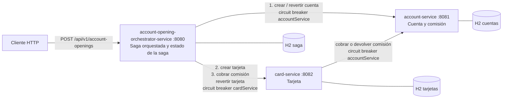

# C4 nivel Container: apertura de cuenta

La compensación recorre el camino inverso: el orquestador pide el reverso de la tarjeta y después el reverso de la cuenta. El reverso de la tarjeta devuelve la comisión cuando el cobro ya se había aplicado. No hay bus de eventos.
